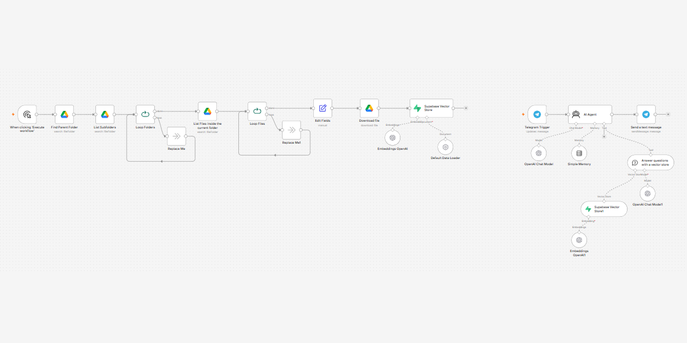

# AI Recipe Allergen RAG



An AI assistant that helps servers answer guest allergen and ingredient questions from the restaurant's own recipe documents, without walking back to the kitchen for every question. Works on a phone or tablet (web page) or in Telegram. Built in n8n.

**Live demo:** [allergen-assistant-nukleix.vercel.app](https://allergen-assistant-nukleix.vercel.app), running on a sample menu for a fusion arancini food truck concept (Around The World Arancini).

> **Status:** Working prototype, built and tested on 16 sample recipe cards I wrote for the demo. Not yet deployed in a live kitchen.

<!-- Demo video goes here -->

## The problem

In food service, staff and guests need fast, accurate answers about ingredients and allergens. Looking it up by hand during a busy service is slow, and answers vary depending on who you ask. I spent 10+ years in kitchens, and this is a question that comes up every shift.

## How it works

The system uses Retrieval-Augmented Generation (RAG):

- Recipe documents are converted into embeddings and stored in a vector database
- When someone asks a question, the most relevant recipes are retrieved
- That recipe text is passed to the LLM, which answers using only what was retrieved
- The answer goes back to the server on the web page (or in Telegram)

Because answers come from the actual recipe documents instead of the model's general knowledge, the assistant stays grounded in your menu and can say when a dish isn't in its data.

## Architecture

Separate n8n workflows: one loads the data, and the question-answering agent is exposed two ways (a web page and Telegram). Recipes are embedded once and stored, so each question is a fast lookup.

### Workflow 1: Document ingestion

```
Trigger (manual or scheduled)
  → Find parent folder (Google Drive)
  → List subfolders → loop folders
  → List files → loop files
  → Normalize metadata
  → Download file
  → OpenAI Embeddings
  → Supabase Vector Store (embeddings + text)
```

### Workflow 2: Question answering (web)

```
Web page for servers (allergen chips + chat)
  → n8n Webhook (POST: question + session ID)
  → AI Agent
      ├─ OpenAI Chat Model
      ├─ Simple Memory (keyed to the browser session)
      └─ Vector Store tool → Supabase → OpenAI Embeddings
  → Respond to Webhook (JSON reply)
```

### Workflow 3: Question answering (Telegram)

```
Telegram Trigger (incoming message)
  → AI Agent
      ├─ OpenAI Chat Model
      ├─ Simple Memory (conversation context)
      └─ Vector Store tool → Supabase → OpenAI Embeddings
  → Send Telegram reply
```

Simple Memory lets people ask follow-ups naturally: "Does the French Onion Arancini have dairy?" then "What about gluten?" The agent knows which dish is still being discussed.

## Tech stack

| Component | Tool |
|---|---|
| Orchestration | n8n |
| LLM | OpenAI chat model |
| Embeddings | OpenAI Embeddings API |
| Vector database | Supabase (pgvector) |
| Data source | Google Drive (recipe documents) |
| Interface | Static web page (Vercel) + Telegram Bot API |

## Example questions

| Question | What the system does |
|---|---|
| Are there nuts in the salad? | Finds the Caribbean Mango Salad and flags the cashews (tree nuts) |
| What can I eat without shellfish? | Lists every shellfish-free item from the menu allergen overview |
| Is the Kimchi Corn Arancini safe for a sesame allergy? | Notes the arancini has no sesame but its default glaze does |
| What's in the remoulade? | Returns the full ingredient list and allergens |
| Do you have a smash burger? | Says the dish isn't in the recipes and suggests asking the kitchen |

## Why RAG instead of a general chatbot?

A general chatbot doesn't know your recipes. Asked about allergens, it will guess based on what the dish usually contains. RAG limits the answer to what's in your recipe documents, which makes answers specific to your menu and easier to audit.

## Safety note

This is a lookup tool, not a replacement for kitchen verification. Answers are only as accurate as the recipe documents behind them, and recipes, substitutions, and cross-contact risks change. For severe allergies, always confirm with the kitchen.

## Results so far

- Pipeline running end to end in n8n, with a public web demo
- Tested on sample recipes: single-dish lookups, "what can I eat without X" lists, follow-up questions, and dishes not on the menu
- Testing caught a real failure: list questions only saw a few recipes and once listed a shellfish dish as shellfish-free. Fixed by adding a menu-wide allergen overview document and retrieving more results, then retested
- New recipes can be added by uploading files to Google Drive and re-running ingestion (the demo menu was loaded with a one-off n8n loader workflow)

## Roadmap

- Automatic re-ingestion when Drive documents change
- Structured allergen table for exact filtering
- Back-of-house prep view: look up recipes and scale batches
- Separate knowledge bases per location
- Query logging for review

## Workflow and implementation

The n8n workflows, prompts, and configuration are not public. This repository documents the architecture and design for portfolio purposes. If you want a similar system for your business, reach out.

## Author

**Blair "Fresh" Jones**, AI automation builder, Nashville, TN
[LinkedIn](https://www.linkedin.com/in/blair-jones-43906112b) · [GitHub](https://github.com/freshn8n) · blairjmail@gmail.com

## License

© Blair Jones. All rights reserved. Shared for portfolio and educational purposes only. The workflow, configuration, and implementation may not be reproduced, distributed, or used commercially without written permission.
